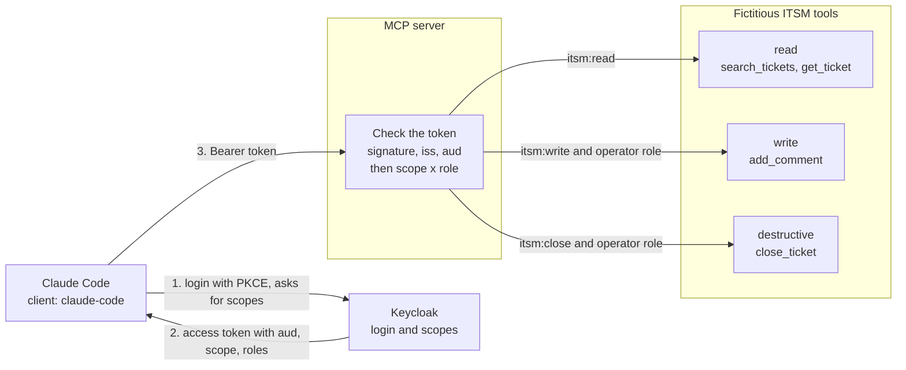

# mcp-authz-reference

A minimal, reproducible reference for securing an MCP server with an OAuth authorization server.
Keycloak is the teaching IdP; the example shows audience binding and scope × role limits on tools.



All data is fictitious. Passwords in `.env.example` are test-only.

## Quick start

Requires Docker and Node 24.

```sh
cp .env.example .env        # optional; tests and compose fall back to .env.example
docker compose up -d --wait # Keycloak 26.8.2 and the MCP server
npm ci
npm test                    # unit tests, no Docker needed
npm run test:e2e            # real tokens from Keycloak against the container
docker compose down -v
```

To connect Claude Code by hand, see [docs/claude-code.md](docs/claude-code.md).

## What this protects, and what it does not

| Protected                                                                                                                                                                   | Not protected yet                                                                                                                                                                                                                       |
| --------------------------------------------------------------------------------------------------------------------------------------------------------------------------- | --------------------------------------------------------------------------------------------------------------------------------------------------------------------------------------------------------------------------------------- |
| A token issued for another MCP server is rejected (`aud` must contain this server's URL).                                                                                   | Sender-constrained tokens (DPoP, mTLS). A stolen bearer token works until it expires.                                                                                                                                                   |
| Tools the caller may not use are not listed, and are checked again on every call. A tool needs both the scope (what the client may do) and the role (what the user may do). | Malicious MCP servers. This repository protects one server, not the client from a bad one.                                                                                                                                              |
| The server does not publish internal hostnames. Authorization server metadata is fetched from the issuer, not served by the MCP server.                                     | Prompt-injection-driven destructive calls. The three tiers only reduce the damage: a client with the `itsm:close` scope and an operator user can still close a ticket if the model is tricked into asking.                              |
|                                                                                                                                                                             | Revocation of tokens already issued. A token stays valid until it expires.                                                                                                                                                              |
|                                                                                                                                                                             | No `Origin` / DNS-rebinding check on the HTTP endpoint. The server is meant for localhost use in this lab.                                                                                                                              |
|                                                                                                                                                                             | The Keycloak workaround binds `aud` through client scopes, so it cannot tie a token to one server when a scope carries several audiences. See the [verification memo](docs/verification/2026-11-18-resource-indicators.md) for details. |

The three tool tiers:

| Tier        | Tools                          | Needs scope  | Needs role                       |
| ----------- | ------------------------------ | ------------ | -------------------------------- |
| read        | `search_tickets`, `get_ticket` | `itsm:read`  | `itsm-viewer` or `itsm-operator` |
| write       | `add_comment`                  | `itsm:write` | `itsm-operator`                  |
| destructive | `close_ticket`                 | `itsm:close` | `itsm-operator`                  |

Test users: `alice` has the operator role, `bob` has the viewer role. The policy is a pure function in
[`src/authz/policy.ts`](src/authz/policy.ts).

## Design notes

- **The server is IdP-neutral.** It does standard JWT checks (JWKS, `iss`, `aud`, `exp`) and reads
  scopes from `scope` and roles from a top-level `roles` claim. Everything Keycloak-specific (realm,
  audience mappers, the `roles` mapper) lives in [`keycloak/`](keycloak/). The realm file is generated
  by `keycloak/setup-realm.sh`; signing keys are stripped from it.
- **Audience binding.** Resource indicators (RFC 8707) are only experimental in Keycloak 26.8.2
  (`--features=resource-indicators`), so the default setup does not rely on them; the
  [verification memo](docs/verification/2026-11-18-resource-indicators.md) compares the flag on and
  off. Instead each `itsm:*` scope has an audience mapper that puts `http://localhost:3000/mcp` into
  `aud`, so asking for the scope is what puts the resource in the token. A token without any `itsm:*`
  scope has no matching `aud` and is rejected with 401.
- **MCP protocol version `2025-11-25`.** SDK 1.32.2 negotiates up to that version. The authorization
  requirements checked here (RFC 9728 protected resource metadata, audience validation) are the same
  as in the 2026-07-28 revision; the version moves up when the SDK supports it.
- **Stateless server.** Every request gets a fresh server and transport; there are no sessions.
- **Test-only things.**
  - `lab-tester` is a client with the password grant (ROPC), used only so the e2e tests can get tokens
    without a browser. OAuth 2.1 removes this grant; do not copy it.
  - The passwords in `.env.example` and the Keycloak admin default in `compose.yaml` are for local
    use only.

## Verified on

| Date       | What                                          | Keycloak | MCP SDK | Node | Result                                      |
| ---------- | --------------------------------------------- | -------- | ------- | ---- | ------------------------------------------- |
| 2026-11-18 | Unit tests and e2e tests (`npm run test:e2e`) | 26.8.2   | 1.32.2  | 24   | Passed                                      |
| TODO       | Claude Code manual walkthrough                | 26.8.2   | 1.32.2  | 24   | Pending (the Claude Code version goes here) |

More: [docs/claude-code.md](docs/claude-code.md) ·
[resource indicators verification memo](docs/verification/2026-11-18-resource-indicators.md)

## License

Apache-2.0. See [LICENSE](LICENSE).
